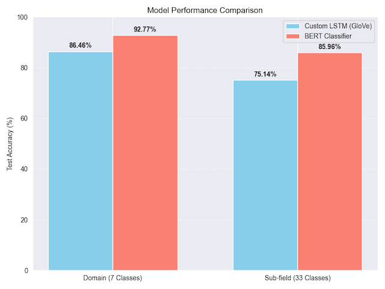
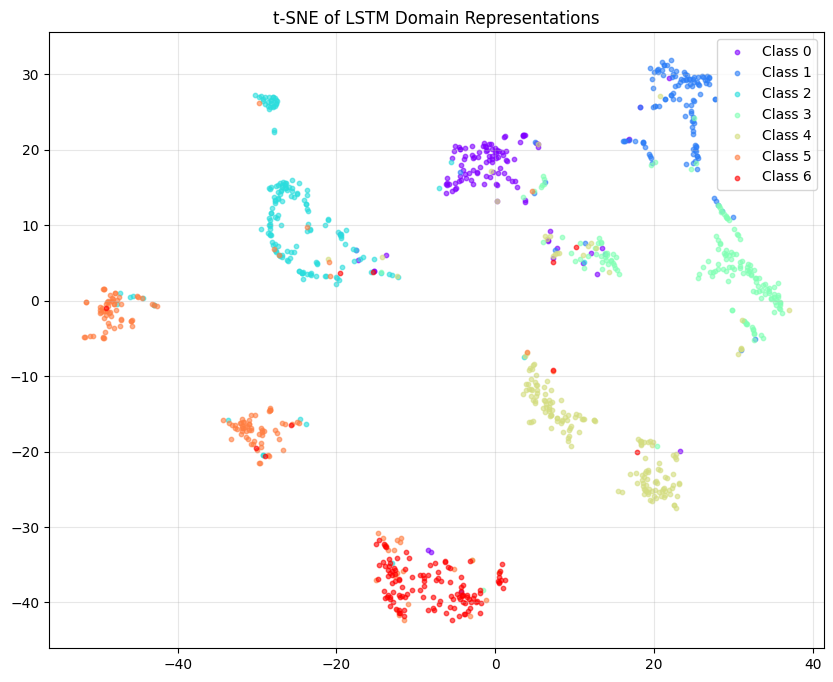
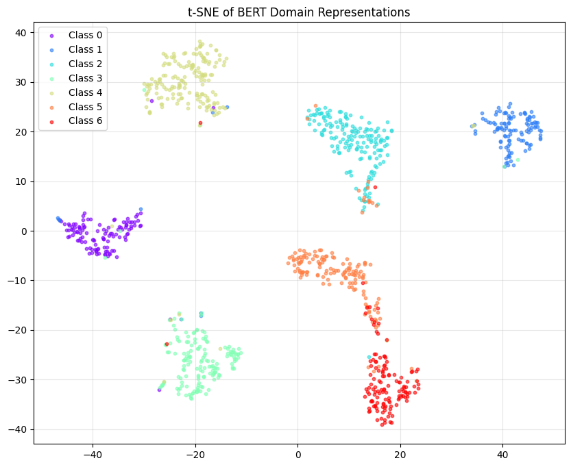
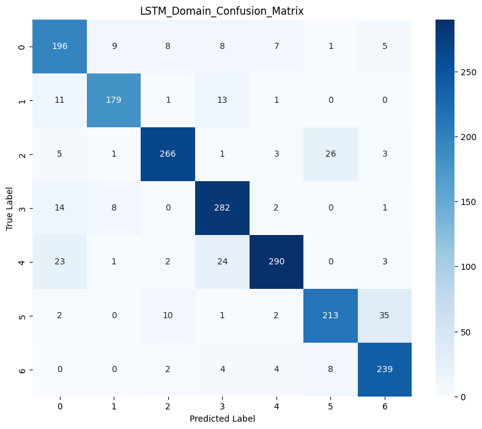
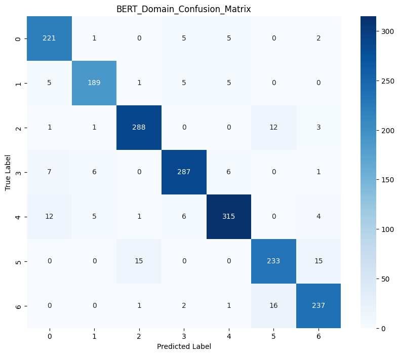

# 🔬 Scientific Text Classification: Custom LSTM vs. Fine-Tuned BERT

[](https://www.python.org/)
[](https://pytorch.org/)
[](https://huggingface.co/)

An empirical NLP benchmark comparing a **from-scratch PyTorch LSTM** (with manual gating math, GloVe embeddings, and token-padding masking) against a **fine-tuned BERT Transformer** (`bert-base-uncased`) on **12,000 scientific abstracts** from the Web of Science (WOS) dataset.

**Author:** [Bahul Mishra](https://github.com/bahulmishra)

---

## 📊 Key Results at a Glance

| Architecture | Word Representation | 7-Domain Task Acc | 33-Subfield Task Acc | Convergence Speed |
| :--- | :--- | :---: | :---: | :---: |
| **Custom LSTM** (from scratch) | GloVe 300d | **86.46%** | **75.14%** | 10–25 epochs |
| **BERT Classifier** (fine-tuned) | WordPiece / Transformer | **92.77%** 🏆 | **85.96%** 🏆 | **1 epoch** |
| **Performance Delta** | — | **+6.31 pp** | **+10.82 pp** | **~10x faster** |

> 📖 **Deep Dive Documentation:** For detailed architectural decisions, gate math derivations, hyperparameter sweep logs, attention maps, and error analyses, see [project.md](project.md).

---

## 🌟 Key Architecture & Implementation Highlights

- **From-Scratch LSTM Cell (`CustomLSTMCell`):** Implements manual gating mathematics ($i_t, f_t, g_t, o_t$) using fused matrix projections (`4 * hidden_size`) with Xavier uniform initialization.
- **Unpadded Token Masking:** Freezes hidden and cell state updates (`h_t = mask * h_next + (1 - mask) * h_t`) when processing trailing `<PAD>` tokens to prevent sequence tail degradation.
- **BERT Fine-Tuning Pipeline:** Extracts `pooler_output` (`[CLS]` representation), leveraging `AdamW` decoupled weight decay with linear warmup learning rate scheduling.
- **6-Dimensional Hyperparameter Search:** Greedy sequential optimization covering Dropout, Learning Rate, Hidden Units, Initializations, L1 Regularization, and GloVe Dimensions (50d–300d).
- **Model Explainability & Visual Diagnostics:**
  - **Self-Attention Heatmaps:** Layer 12 / Head 1 attention extraction comparing correct vs. incorrect predictions.
  - **Latent Space Clustering:** Forward hook feature extraction + t-SNE 2D dimensionality reduction.
  - **Error Root-Cause Analysis:** Isolated top confident misclassifications (e.g., Mechanical vs. Civil Engineering vocabulary overlap).

---

## 📈 Visual Benchmark Artifacts

### Model Performance Comparison


### Latent Feature Space Clustering (t-SNE)
| Custom LSTM (GloVe 300d) | Fine-Tuned BERT |
| :---: | :---: |
|  |  |

### Confusion Matrix (7 Scientific Domains)
| Custom LSTM (GloVe 300d) | Fine-Tuned BERT |
| :---: | :---: |
|  |  |

---

## 📂 Project Structure

```
.
├── main.py                 # Standalone execution pipeline (sweeps + training + evaluation)
├── notebook.ipynb          # Interactive research notebook
├── optimized.ipynb         # TorchScript C++ JIT compiled notebook
├── project.md              # Comprehensive technical report & architecture design
├── README.md               # Portfolio overview & setup guide
├── requirements.txt        # Python dependency manifest
├── .gitignore              # Git tracking rules
└── figures/                # 29 benchmark visualization plots
```

---

## 🚀 Quick Start & Environment Setup

### 1. Prerequisites
Ensure Python 3.10+ and PyTorch are installed.

```bash
git clone https://github.com/bahulmishra/seq2vec-nlp-text-classification-lstm-bert.git
cd seq2vec-nlp-text-classification-lstm-bert
pip install -r requirements.txt
```

### 2. Dataset Setup
- **Web of Science Dataset:** Download `WOS11967` and place it inside `WebOfScienceDataset/WOS11967/`.
- **GloVe Embeddings:** Download `glove.6B.zip`, extract, and place `glove.6B.300d.txt` inside `glove.6B/`.

### 3. Execution Options

**Option A: Run Complete Python Pipeline**
```bash
python main.py
```

**Option B: Interactive Notebooks**
```bash
jupyter lab notebook.ipynb
```

---

## 📜 Citation & References
1. Devlin, J., et al. (2019). *BERT: Pre-training of Deep Bidirectional Transformers for Language Understanding*. NAACL.
2. Pennington, J., et al. (2014). *GloVe: Global Vectors for Word Representation*. EMNLP.
3. Kowsari, K., et al. (2017). *HDLTex: Hierarchical Deep Learning for Text Classification*. IEEE ICMLA.

