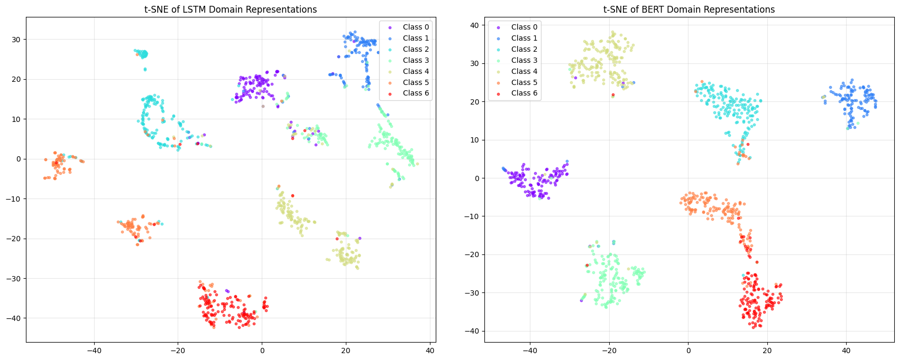
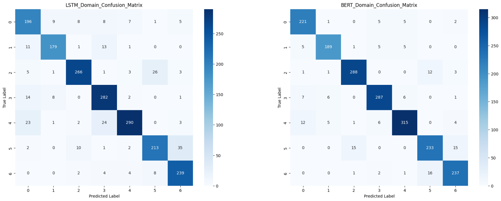

# nlp-text-classification-lstm-bert
Comparative study of a custom LSTM (implemented from scratch) vs. fine-tuned BERT for scientific abstract classification on the Web of Science dataset. Includes custom LSTM cells with GloVe embeddings, BERT fine-tuning, hyperparameter search, attention visualization, and t-SNE feature space analysis.

* Bahul Mishra






## Prerequisites
* Python 3.8+ (we are using python 3.12)
* Packages in requirements.txt
```bash
pip install -r requirements.txt
```

## Data Setup
- WebOfScience Dataset: download and place the folder `WebOfScienceDataset` in the project root
- GloVe Embeddings: download `glove.6B.zip`, extract it, and place `glove.6B.300d.txt` inside a folder named `glove.6B/`.

## Running the Code
Notebook is structured in 3 main sections:
- Processing the data
- Implementation of LSTM and BERT models
- Running of Experiments

Launch the Jupyter Notebook / JupyterLab from your terminal (or use PyCharm/VSCode) and click run, all the tests will start running automatically
