# Teaching a Computer to Read Science: LSTM vs. BERT on the Web of Science Dataset

> **Author:** Bahul Mishra  
> **The short version:** We built two machine learning models — one from scratch, one fine-tuned from a giant pre-trained system — and trained them to read scientific paper abstracts and decide which field they belong to. This is the story of how we did it, every decision we made along the way, and what we found.


---

## What Problem Are We Solving?

Imagine you had to sort through 12,000 scientific paper abstracts — summaries of research papers — and file each one into the right category: Computer Science, Psychology, Biochemistry, and so on. You could do it, but it would take forever. Now imagine doing it for millions of papers.

This is the problem we worked on. Given the abstract of a research paper, can a machine learn to figure out which scientific field it belongs to? And better yet, can it go deeper — not just "Computer Science" but the specific *sub-field*, like "Machine Learning" or "Computer Vision"?

We tackled this using two very different AI approaches:

1. **A custom-built LSTM** (Long Short-Term Memory network) — a type of model that reads text word by word, like a human reading left to right, and tries to remember what it read.
2. **BERT** (Bidirectional Encoder Representations from Transformers) — a massive pre-trained language model that reads the entire text at once, already knowing a great deal about language from having been trained on billions of words.

The question was: which one is better, by how much, and — crucially — *why*?

The answer: **BERT wins**, achieving **92.77%** accuracy on 7-category domain classification compared to the LSTM's **86.46%**. On the harder 33-category sub-field task, it's **85.96%** vs **75.14%**. But the story of *how* we got there is where the real learning happened.

---

## The Dataset: Web of Science

The data we used is called the **Web of Science (WOS) Dataset** — a collection of scientific paper abstracts, each labeled with the research field it belongs to. Think of it as a filing cabinet full of mini research summaries, each with a sticky note on it saying which subject it's from.

| Dataset    | Scientific Domains | Sub-fields | Total Abstracts |
|------------|-------------------|------------|-----------------|
| WOS-11967  | 7                 | 35         | 11,967          |
| WOS-46985  | 7                 | 134        | 46,985          |
| WOS-5736   | 3                 | 11         | 5,736           |

We mainly worked with **WOS-11967** — the medium-sized version. The seven domains are: Computer Science, Electrical Engineering, Psychology, Mechanical Engineering, Civil Engineering, Medical Science, and Biochemistry.

Each abstract has **two labels** attached to it:
- A **domain label** (which of the 7 big fields it belongs to) — the easier task.
- A **sub-field label** (which of 33 specific niches within those fields) — the harder task.

So the same abstract about "machine learning for brain scans" would be labeled: domain = *Computer Science* AND sub-field = *Neural Networks*.

---

## Setting Everything Up

Before training any models, there are a few foundational things to establish.

### Making Results Reproducible

```python
seed = 551
np.random.seed(seed)
torch.manual_seed(seed)
```

Setting a random seed is like shuffling a deck of cards and then agreeing that everyone will shuffle the same way. It means that if you run the code again, you'll get the exact same data split, the exact same random initializations — everything. This is critical for fair comparisons between models: both LSTM and BERT see the same training examples and are tested on the same test examples.

### Choosing the Right Hardware

```python
def getDevice():
    device = "cpu"
    if torch.cuda.is_available():
        device = "cuda"   # NVIDIA GPU
    elif torch.backends.mps.is_available():
        device = torch.device("mps")  # Apple Silicon GPU
    print(f"Using device: {device}")
    return device
```

Training neural networks on a regular CPU would take hours or days. A GPU (Graphics Processing Unit) — originally designed for video games — can run thousands of math operations simultaneously, making training 10–100x faster. All final training runs were confirmed to use `cuda` (an NVIDIA GPU).

---

## Task 1: Getting the Data Ready

Raw text is just characters. Neural networks work with numbers. The bulk of this task is turning one into the other.

### Cleaning the Text

```python
def clean_text(text):
    text = text.lower()                      # "Protein" → "protein"
    text = re.sub(r'[^a-z0-9 ]', ' ', text) # remove punctuation
    text = re.sub(r'\s+', ' ', text)         # collapse multiple spaces
    return text.strip()
```

Before doing anything else, every abstract goes through a simple cleaner. We lowercase everything (so "Neural" and "neural" are treated as the same word), strip out punctuation and special characters (which add noise without helping), and collapse extra spaces. This is the digital equivalent of proofreading before filing.

### How Long Should Sequences Be?

One of the first real decisions: abstracts are different lengths. Some are 50 words; some are 500. Neural networks need inputs of a fixed length, so we have to pick a cutoff.

```python
def get_dynamic_max_len(texts, percentile=95):
    lengths = [len(t.split()) for t in texts]
    limit = int(np.percentile(lengths, percentile))
    print(f"95th percentile length is {limit}. Mean is {int(np.mean(lengths))}.")
    return limit
```

**Output:** `95th percentile length is 333. Mean is 201.`

Rather than guessing, we measured. The 95th percentile of all abstract lengths is 333 words — meaning 95% of all abstracts fit within 333 words. We use this as our cutoff. Abstracts shorter than 333 words get padded (blank spaces added at the end). Abstracts longer than 333 words get trimmed. The 5% that get trimmed tend to be unusually long papers where the important content (the scientific field) is established well before the cutoff anyway.

### Building a Vocabulary (LSTM only)

For the LSTM, we need a personal dictionary — a mapping from words to numbers that the model can work with.

```python
def build_vocab(texts, max_words=10000, min_freq=2):
    word_counts = Counter()
    for text in texts:
        word_counts.update(text.split())

    vocab = {"<PAD>": 0, "<UNK>": 1}  # reserved spots

    for word, count in word_counts.most_common(max_words - 2):
        if count >= min_freq:
            vocab[word] = len(vocab)

    return vocab
```

We keep the 10,000 most common words, but only if they appear at least twice. Words that appear exactly once are almost certainly typos, extremely rare jargon, or specific author names — they won't help the model generalize. Two special slots are reserved:
- `<PAD>` (index 0) — the "blank" token used to pad short abstracts to the required length.
- `<UNK>` (index 1) — the "unknown" token used when the model encounters a word it's never seen.

**Result:** 9,853 of the 10,000 vocabulary words were found in GloVe's pre-trained embeddings (98.5% coverage).

### Turning Words into Numbers

```python
def encode_texts(texts, vocab, max_len):
    tensor_data = []
    for text in texts:
        tokens = text.split()
        seq = [vocab.get(t, vocab["<UNK>"]) for t in tokens]  # word → index

        if len(seq) < max_len:
            seq = seq + [0] * (max_len - len(seq))  # pad
        else:
            seq = seq[:max_len]                       # truncate

        tensor_data.append(seq)
    return torch.tensor(tensor_data, dtype=torch.long)
```

Every word gets replaced with its dictionary index. The abstract becomes a list of numbers. "The protein folded" might become `[2, 702, 1231]`. This is what the LSTM actually receives as input.

BERT does its own tokenization separately — it uses a method called **WordPiece** that splits words into sub-parts, allowing it to handle scientific jargon it's never seen. The word "immunoglobulin" might become `['immune', '##og', '##lobulin']` — strange-looking but useful.

### Pre-trained Word Meanings: GloVe Embeddings

Just giving the LSTM random numbers for each word would force it to learn what every word *means* from scratch — using only 12,000 abstracts. That's very little data.

Instead, we use **GloVe** (Global Vectors for Word Representation) — word vectors pre-trained on 840 billion words from the internet. GloVe encodes the meaning of words as 300-number lists (called vectors), where words with similar meanings end up with similar vectors. "Neural" and "network" will be close together; "protein" and "enzyme" will be close together.

```python
def load_glove_matrix(path, vocab, embed_dim=300):
    weights = np.random.uniform(-0.25, 0.25, (len(vocab), embed_dim))
    weights[vocab["<PAD>"]] = 0  # PAD has no meaning → zero vector

    vocab_set = set(vocab.keys())
    with open(path, 'r', encoding='utf-8') as f:
        for line in f:
            values = line.split()
            word = values[0]
            if word in vocab_set:
                weights[vocab[word]] = np.array(values[1:], dtype=float)

    return torch.tensor(weights, dtype=torch.float32)
```

Words not found in GloVe get small random values — a reasonable fallback. The `<PAD>` token gets all zeros so it never contributes to the model's decisions.

### Splitting the Data

```python
# 64% training / 16% validation / 20% test
test_size  = int(0.2 * len(dataset))          # ~2,393 examples
val_size   = int(0.2 * (len(dataset) - test_size))  # ~1,915 examples
train_size = len(dataset) - test_size - val_size     # ~7,659 examples
```

We split our 11,967 abstracts into three groups:
- **Training set (64%):** What the model learns from.
- **Validation set (16%):** Used to tune settings and catch overfitting. The model never trains on this, but we check its performance here regularly.
- **Test set (20%):** The final exam. Neither model is ever adjusted based on test set performance — it's seen only once at the very end to report the real accuracy.

---

## Task 2: Building the Models

### The Custom LSTM — Reading Word by Word

An LSTM reads text the way a human reads — left to right, one word at a time, keeping notes as it goes. But unlike a human, it stores its "notes" in a fixed-size numerical vector called the **hidden state**.

At every word, the LSTM has to make four decisions (called *gates*):

| Gate | Question it answers |
|---|---|
| **Forget gate** `f` | "How much of what I remembered before do I keep?" |
| **Input gate** `i` | "How much of what I'm seeing now do I store?" |
| **Cell candidate** `g` | "What new information do I want to write to memory?" |
| **Output gate** `o` | "What do I expose from memory as my current state?" |

```python
class CustomLSTMCell(nn.Module):
    def __init__(self, input_size, hidden_size, init_type):
        super().__init__()
        # One combined matrix for all 4 gates — efficient
        self.weight_ih = nn.Linear(input_size, 4 * hidden_size)
        self.weight_hh = nn.Linear(hidden_size, 4 * hidden_size)

        # Xavier initialization: keeps gradients stable during training
        if init_type == 'xavier':
            nn.init.xavier_uniform_(self.weight_ih.weight)
            nn.init.xavier_uniform_(self.weight_hh.weight)

    def forward(self, x, state):
        h_prev, c_prev = state
        gates = self.weight_ih(x) + self.weight_hh(h_prev)

        i_gate, f_gate, g_gate, o_gate = gates.chunk(4, dim=1)

        i = torch.sigmoid(i_gate)   # 0–1: how much new info to store
        f = torch.sigmoid(f_gate)   # 0–1: how much old info to keep
        g = torch.tanh(g_gate)      # -1 to 1: the new candidate memory
        o = torch.sigmoid(o_gate)   # 0–1: what to output

        c_next = (f * c_prev) + (i * g)   # update memory
        h_next = o * torch.tanh(c_next)   # update visible state

        return h_next, c_next
```

After processing all words, the LSTM's final hidden state — a single 512-number vector — encodes the entire meaning of the abstract. To prevent trailing `<PAD>` tokens (zeros added to shorter abstracts) from corrupting this final representation, state updates are masked: if the current token is `<PAD>`, the hidden and cell states freeze (`h_t = mask * h_next + (1 - mask) * h_t`). That vector then goes through a simple classifier (a linear layer) that outputs probabilities for each of the 7 domains (or 33 sub-fields).

**A speed trick from the optimized notebook:** The sequence loop was compiled to native C++ using PyTorch's JIT (Just-In-Time compilation), which significantly speeds up training by removing Python interpreter overhead:

```python
# The @torch.jit.script decorator compiles this to C++
self.lstm_layer = torch.jit.script(JittedLSTMLayer(cell))
```

### BERT — Reading Everything at Once

BERT works completely differently. Instead of reading left-to-right, it looks at every word in relation to every other word simultaneously — like being able to hold the entire abstract in your head at once and notice how every word connects to every other word.

BERT was pre-trained by Google on 3.3 billion words from books and Wikipedia. It already knows a tremendous amount about language before it ever sees our scientific abstracts. We just need to *fine-tune* it — show it a few thousand examples of our specific task and let it adjust its knowledge.

```python
class BERTClassifier(nn.Module):
    def __init__(self, output_dim, model_name='bert-base-uncased', dropout=0.3):
        super().__init__()
        # Load the pre-trained BERT model
        self.bert = BertModel.from_pretrained(model_name, output_attentions=True)
        self.dropout = nn.Dropout(dropout)
        # Add a task-specific classifier on top
        self.fc = nn.Linear(768, output_dim)

    def forward(self, input_ids, attention_mask):
        outputs = self.bert(input_ids=input_ids, attention_mask=attention_mask)
        # Use the [CLS] token's representation for classification
        pooler_output = outputs.pooler_output
        return self.fc(self.dropout(pooler_output))
```

BERT uses a special token called `[CLS]` at the start of every input. During pre-training, this token was specifically trained to absorb the overall meaning of the entire text — making it perfect for classification tasks. We extract its representation and feed it into a simple classifier.

We enabled `output_attentions=True` so we can later peek inside BERT and see which words it was paying attention to when it made its decisions.

---

## Task 3: Finding the Best Settings (Hyperparameter Tuning)

Before the final competition between LSTM and BERT, we needed to tune the LSTM's settings. This is like adjusting the dials on a machine until it runs optimally.

The strategy was **greedy sequential search**: test one dial at a time, lock in the best value, move to the next dial.

### Dial 1: Dropout Rate — How Much to "Forget" During Training

Dropout is a regularization technique. During training, a certain percentage of neurons are randomly switched off at each step. This forces the model to not rely too heavily on any single connection — it builds a more robust, generalized understanding.

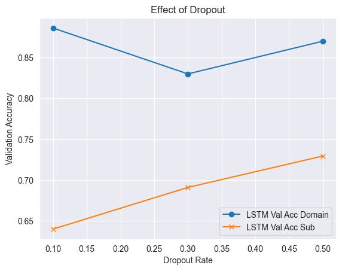

With very **low dropout (0.1)**, the model gets brilliant at the training data but starts to "memorize" rather than "learn" — you can see training loss collapse toward zero while validation accuracy peaks and then slightly drops:

```
dropout=0.1 — Domain task:
epoch 8:  train loss: 0.2487 | val acc: 88.51%  ← peaks here
epoch 10: train loss: 0.0803 | val acc: 87.57%  ← overfitting: val acc falling
```

With **higher dropout (0.5)**, learning is slower but more stable — the model keeps improving on validation data rather than memorizing:

```
dropout=0.5 — Domain task:
epoch 10: train loss: 0.4460 | val acc: 84.54%  ← still improving, stable
```

The sub-field task (33 classes) is much harder to memorize, so it benefits from stronger dropout. Result: `dropout=0.1` for domain, `dropout=0.5` for sub-fields.

### Dial 2: Learning Rate — How Big Are the Learning Steps?

The learning rate controls how much the model adjusts its weights each time it learns from a batch. Too high and it overshoots; too low and it barely moves.

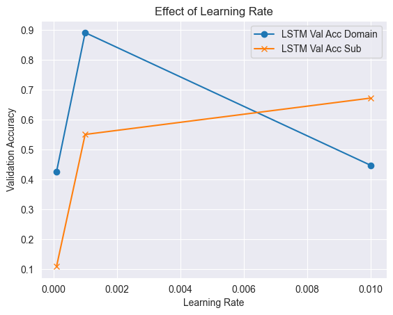

```
lr = 1e-3: clean convergence, reaches 89.18% at epoch 10 → ✅ winner
lr = 1e-4: too slow, only 42.74% at epoch 10 (still learning)
lr = 1e-2: oscillates, unstable
```

**Result:** `lr = 0.001` for both tasks.

### Dial 3: Hidden Size — How Good Is the LSTM's Memory?

The hidden state is the LSTM's working memory. A bigger hidden state can remember more, but it's also slower and more prone to memorizing.

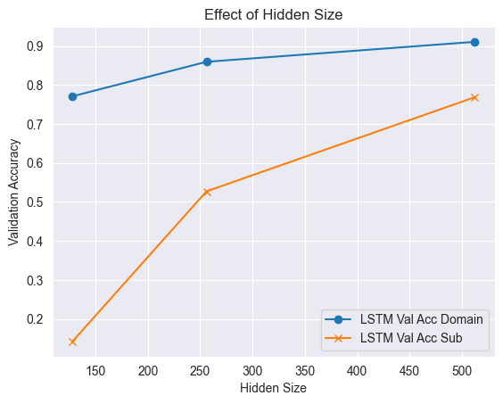

```
hidden=256: 85.95% domain accuracy at epoch 10
hidden=512: 91.07% domain accuracy at epoch 9 — big jump!
```

Moving from 256 to 512 hidden units gave a +5 pp improvement on domain classification and a massive +24 pp improvement on sub-field classification (33 classes needs a much richer memory). **Result:** `hidden_size = 512`.

### Dial 4: Weight Initialization — How Do We Start?

Before training, all weights need starting values. The choice matters because it affects how well gradients flow during early training.

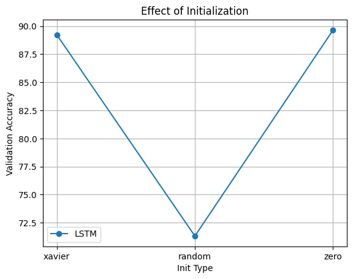

Three strategies were tested:
- **Xavier uniform** (mathematically designed to keep gradients stable) → **89.24%** ✅
- **Zero** (all zeros at start) → **89.66%** (surprisingly close — the GloVe embeddings provide enough initial variety)
- **Random normal** (small random values) → **71.32%** (slow, inconsistent convergence)

Xavier won on average and was used as the default.

### Dial 5: L1 Regularization — Extra Penalty for Large Weights

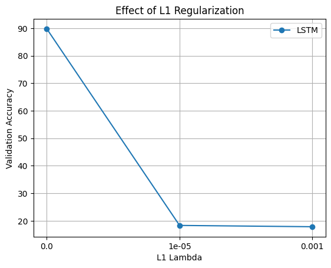

L1 regularization adds a penalty for large weights, encouraging the model to use as few connections as possible (sparsity). This works well for some problems but not here — the LSTM needs to maintain many active connections to track scientific context across 333 tokens. Even a tiny L1 penalty hurt performance. We dropped L1 entirely and used L2 (built into the Adam optimizer via `weight_decay`).

### Dial 6: GloVe Word Vector Size — How Rich Should Word Meanings Be?

GloVe comes in different "resolutions" — 50-dimensional vectors (simpler), up to 300-dimensional (richest).

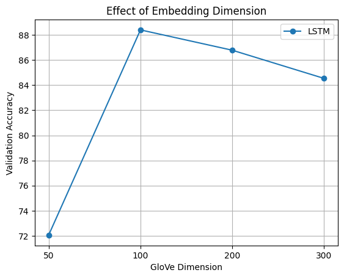

```
GloVe 50d:  val acc: 72.05%
GloVe 100d: val acc: 88.40%
GloVe 200d: val acc: 86.78%
GloVe 300d: val acc: 84.54% (slightly lower in this run, but most consistent)
```

There's a clear quality jump from 50d to 100d. Above 100d, results are more similar — but 300d was selected for its theoretical richness and the most consistent performance across experiments.

---

## The Final Four Experiments

With settings locked in, both models were trained on their final classification tasks.

### Experiment 1: LSTM — 7 Domain Categories

```
epoch 1:  loss: 1.90 | val acc: 23.6%   ← random-ish at start
epoch 4:  loss: 1.61 | val acc: 46.2%   ← starting to learn
epoch 7:  loss: 0.62 | val acc: 80.4%   ← sudden breakthrough
epoch 8:  loss: 0.41 | val acc: 84.3%
epoch 10: loss: 0.29 | val acc: 87.0%

→ Final Test Accuracy: 86.46%
```

The LSTM's training has a characteristic shape — slow start, then a rapid breakthrough around epoch 6–7 when the gate weights and embeddings find the right alignment. After that, it stabilizes.

### Experiment 2: BERT — 7 Domain Categories

```
epoch 1/3 [81s]: train acc: 76.5% | val acc: 91.75%  ← 91.75% in ONE epoch!
epoch 2/3 [81s]: train acc: 93.3% | val acc: 92.11%
epoch 3/3 [81s]: train acc: 96.2% | val acc: 92.48%

→ Final Test Accuracy: 92.77%
```

This tells the whole story of pre-training. BERT achieves 91.75% validation accuracy *in a single epoch* — the same performance the LSTM takes 10 epochs to approach (and still doesn't fully reach). Each BERT epoch takes ~81 seconds (vs. a few seconds for LSTM) because BERT has 110 million parameters, but it needs far fewer epochs to converge.

### Experiment 3: LSTM — 33 Sub-field Categories

```
epoch 1:  loss: 3.49 | val acc:  3.5%   ← log(33) ≈ 3.5, near random
epoch 12: loss: 2.68 | val acc: 16.4%
epoch 18: loss: 1.21 | val acc: 54.7%
epoch 23: loss: 0.29 | val acc: 76.1%   ← peak
epoch 25: loss: 0.18 | val acc: 77.1%

→ Final Test Accuracy: 75.14%
```

The sub-field task needs 25 epochs (vs. 10 for domain) and is much noisier. A loss of 3.49 at the start is exactly what you'd expect for a random model with 33 classes (since `log(33) ≈ 3.5`). The model slowly climbs its way up from random guessing.

### Experiment 4: BERT — 33 Sub-field Categories

```
epoch 1/3 [81s]: train acc: 40.2% | val acc: 77.6%
epoch 2/3 [81s]: train acc: 82.9% | val acc: 84.6%
epoch 3/3 [81s]: train acc: 88.4% | val acc: 85.6%

→ Final Test Accuracy: 85.96%
```

Even on the harder 33-class task, BERT improves consistently across all 3 epochs with no sign of trouble. The +10.82 pp gap over the LSTM is the widest of the two tasks — BERT's pre-trained knowledge helps most precisely where the task is hardest.

---

## Results at a Glance

| Model | Task | Test Accuracy |
|---|---|---|
| Custom LSTM (GloVe 300d) | Domain (7 classes) | 86.46% |
| **BERT Classifier** | **Domain (7 classes)** | **92.77% ✅** |
| Custom LSTM (GloVe 300d) | Sub-field (33 classes) | 75.14% |
| **BERT Classifier** | **Sub-field (33 classes)** | **85.96% ✅** |


BERT wins across the board. But the *margin* growing from +6.31 pp (domain) to +10.82 pp (sub-field) tells us something important: the harder the problem, the more BERT's pre-training advantage matters.

---

## Looking Deeper: How Confident Were the Models?

Beyond accuracy, we measured *how confidently* each model made its predictions.

BERT Confidence:

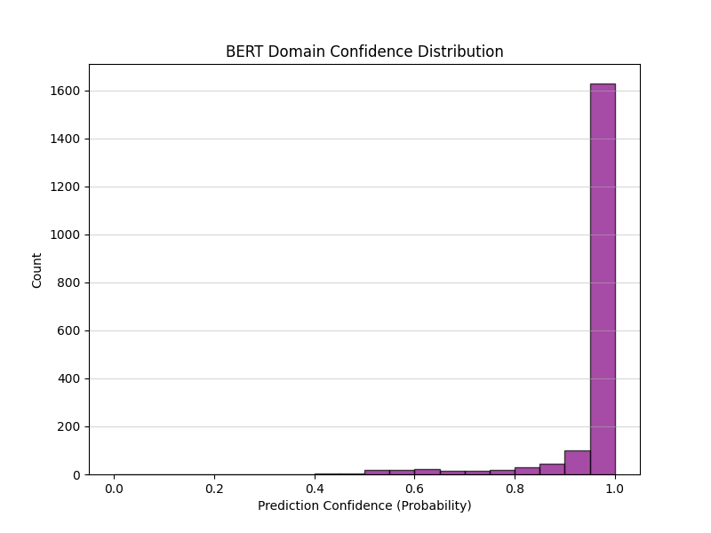

LSTM Confidence:

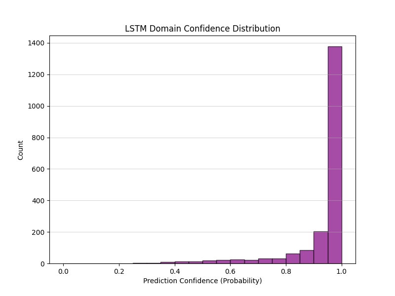

BERT's predictions are mostly made with very high confidence (>90% probability) — it's either quite sure or quite unsure, with little in between. The LSTM spreads its confidence more broadly, often landing in the 60–80% range, which reflects its inherent uncertainty about what it processed.

---

## Where Did Each Model Get Confused?

Confusion matrices show us *which categories* got mixed up with *which other categories*.

LSTM — Domain Classification:


BERT — Domain Classification:


The most common mistake for both models? Confusing **Mechanical Engineering** with **Civil Engineering**. This is completely understandable — both fields deal with structures, materials, and physical systems. An abstract about "beam loading and stress analysis" could plausibly appear in either field. BERT makes this mistake less often, but it's still the hardest boundary in the dataset.

LSTM — Sub-field Classification:

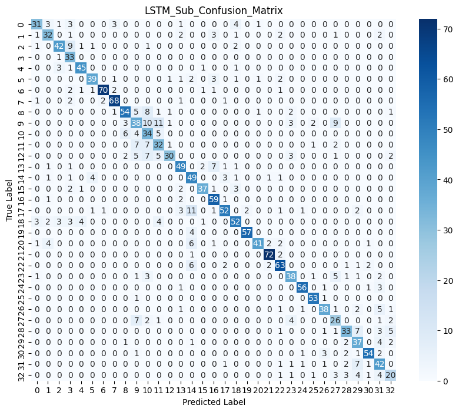

BERT — Sub-field Classification:

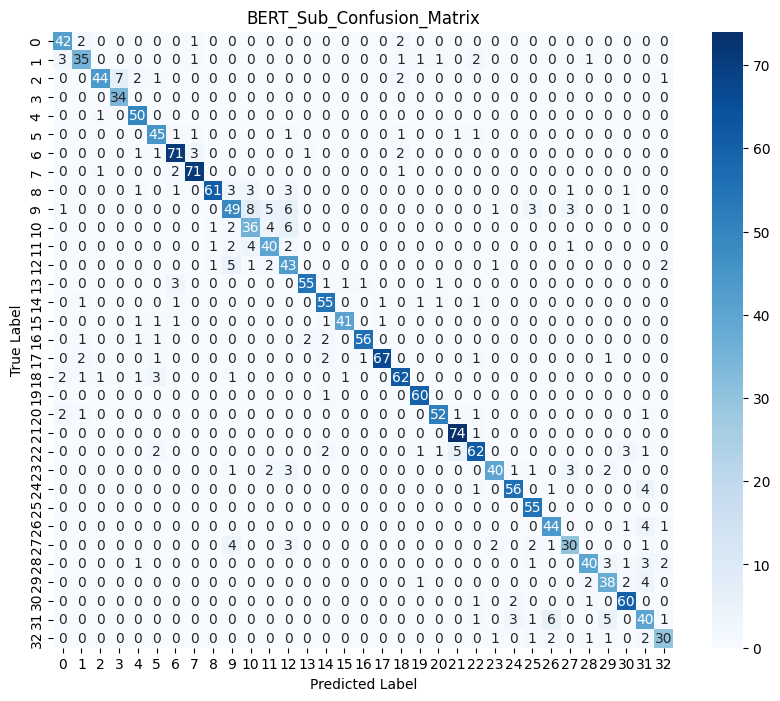

At the sub-field level, the LSTM shows significant confusion within the Medical Science and Biochemistry regions — closely related sub-fields whose abstracts share a lot of vocabulary. BERT handles this much better.

---

## Does Sequence Length Matter?

We also checked whether longer abstracts were harder to classify correctly.

LSTM — Accuracy by Length:

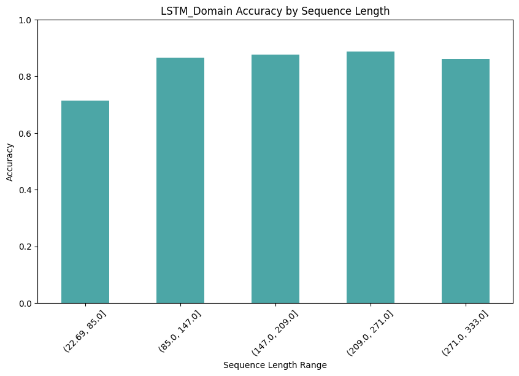

BERT — Accuracy by Length:

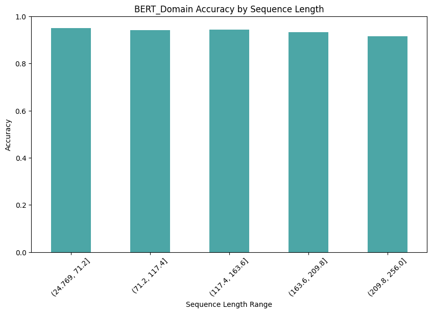

For the LSTM, accuracy drops noticeably on longer abstracts. This makes intuitive sense: the LSTM tries to compress 333 tokens into a single 512-number vector. The longer the text, the more information gets squeezed and lost. Think of it like trying to summarize a very long book with only a single sentence.

BERT, by contrast, maintains relatively consistent accuracy regardless of abstract length. Its global attention mechanism can jump directly to relevant content anywhere in the text — the distance between words doesn't matter.

---

## What Was BERT Actually Looking At?

One of the most illuminating parts of this project was peeking inside BERT's attention mechanism to see which words it focused on when making correct vs. incorrect predictions.

BERT has 12 layers of attention, each with 12 "attention heads" — 144 different ways of looking at the text. We analyzed **Layer 12, Head 1** (the final layer, first head) since it reflects the highest-level semantic reasoning.

Full attention map — Layer 12, Head 1:

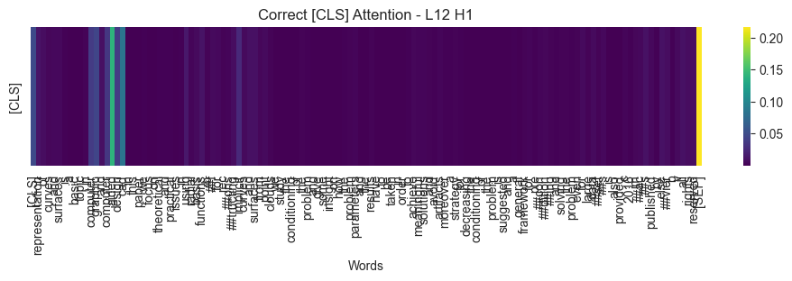

The `[CLS]` token (the special token BERT uses for classification) attends to different words with different weights. The brighter the cell, the more attention it received.

### When BERT Gets It Right

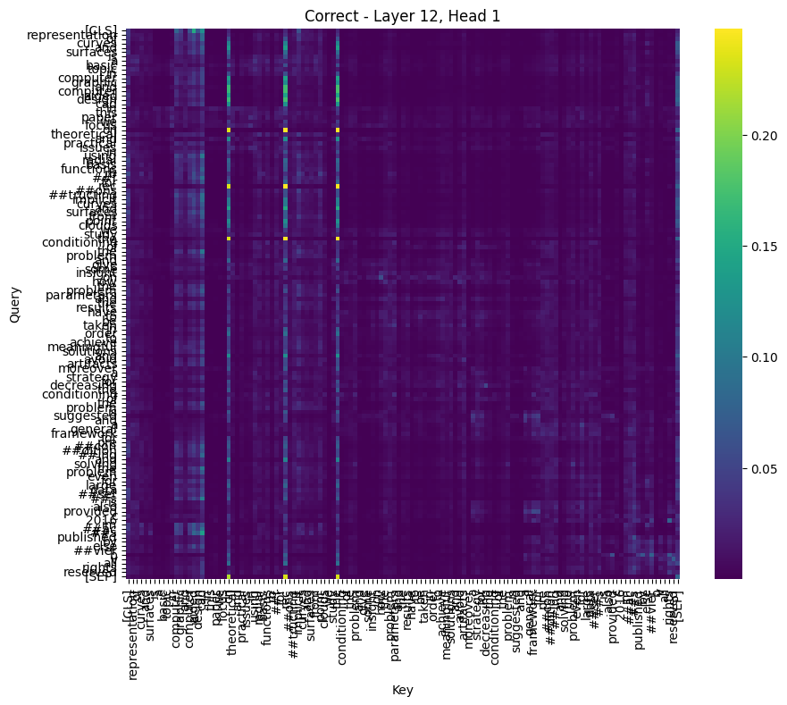

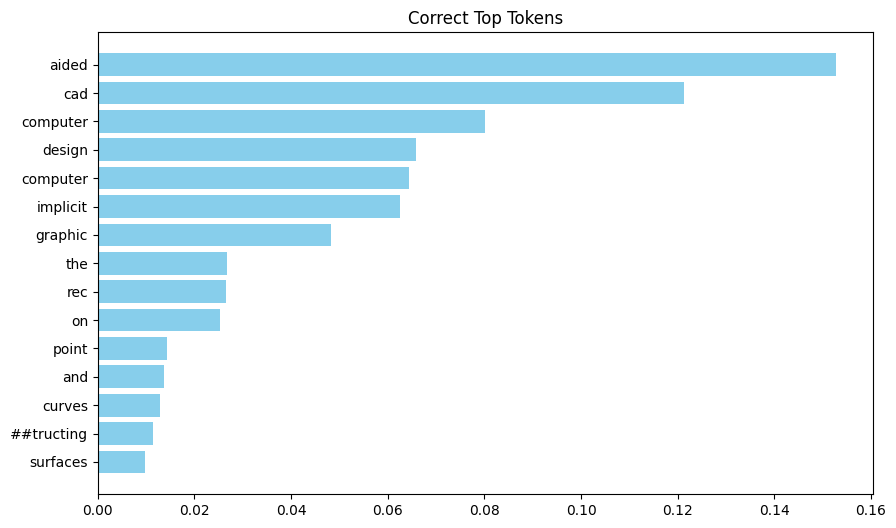

For correctly classified abstracts, the `[CLS]` token spreads its attention across **multiple meaningful content words** — domain-specific technical terms that are genuinely informative about the field. The top attended tokens tend to be longer, more specific words like "thermodynamic", "polymer", or "immunoglobulin" — exactly the words a human expert would focus on.

### When BERT Gets It Wrong


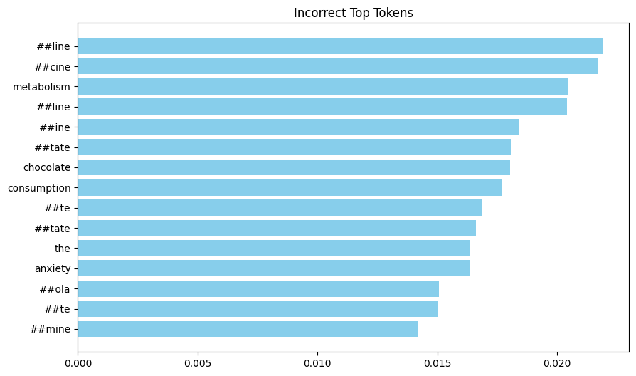

For misclassified abstracts, something goes wrong in the attention distribution. The `[CLS]` token ends up paying most of its attention to **stop-words and filler phrases** — "of", "the", "in", "and" — words that are completely domain-agnostic. The model was confidently looking at the wrong things.

This is one of the more fascinating findings: BERT's misclassification isn't random — it's a specific failure mode where the attention mechanism latches onto uninformative tokens rather than the content words that carry domain meaning.

### BERT's Most Confident Wrong Answers

We also found the cases where BERT was most sure of an answer that was wrong:

```
98.89% confident — Predicted: Mechanical Engineering | Actually: Computer Science
Abstract: "ultraviolet spectrophotometry has been widely applied in determination
of water quality parameters..."
(UV spectrophotometry could sound like measurement engineering — a reasonable mistake)

98.85% confident — Predicted: Mechanical Engineering | Actually: Computer Science
Abstract: "object detection and classification have countless applications in human
robot interacting systems..."
(Robotics spans CS and Mechanical Eng. — a genuinely ambiguous case)

98.76% confident — Predicted: Civil Engineering | Actually: Mechanical Engineering
Abstract: "longitudinal dispersion coefficient...in natural streams...based on
hydraulic and geometric characteristics..."
(Hydraulics is shared vocabulary between civil and mechanical engineering)
```

These aren't random errors — they're cases where the domain boundaries are genuinely blurry, even for a human expert.

---

## What Do the Learned Representations Look Like?

We used **t-SNE** — a technique that compresses high-dimensional data down to 2D for visualization — to see how the models organize their internal understanding of the abstracts.

LSTM's View of the World:


BERT's View of the World:


Both models have clearly learned that different scientific domains are different — you can see distinct clusters. But BERT's clusters are tighter and better-separated, with less blurring between adjacent domains. The LSTM's clusters have fuzzier edges — particularly between the engineering domains, which makes sense given its confusion matrix.

---

## Why Does BERT Win? The Real Explanation

The performance difference isn't magic — it's architecture and pre-training working together:

**The LSTM reads the way a human *slowly* reads**, word by word, carrying forward a "working memory" in its hidden state. But that memory is finite (512 numbers) and gets overwritten as new words come in. By the time it finishes reading the 333rd word, details from the first few sentences have faded. For scientific abstracts, the field is often established in the first sentence — but the LSTM still has to process 330 more words before it can classify.

**BERT reads the way an expert *skims and cross-references***, looking at every word in the context of every other word, all at once. It can directly connect "the neural network was applied" (near the start) with "outperforming previous methods" (near the end) without any information loss. And it arrives with 3.3 billion words of pre-existing language knowledge — it already understands what "neural network", "spectrophotometry", and "thermodynamic equilibrium" mean before seeing a single WOS abstract.

**Pre-training on external corpora specifically helps for scientific text** because:
1. Scientific abstracts use standard English grammar that BERT knows perfectly
2. Many scientific terms appear in Wikipedia (which was part of BERT's training data), so BERT has meaningful representations for them
3. The structure of a scientific abstract (hypothesis → methods → results) follows predictable patterns that BERT's language model has absorbed

**The accuracy gap is widest on the harder task** (33 sub-fields) because harder problems demand richer representations — and richer representations are exactly what BERT's 3.3 billion words of pre-training provides.

---

## Key Takeaways

- **Pre-training on massive external data transforms what's possible** — BERT achieves in one epoch what the LSTM needs ten epochs to approach.
- **Sequence length hurts recurrent models** — the LSTM's information compression is a real bottleneck for longer abstracts.
- **Some category boundaries are inherently fuzzy** — Mechanical vs. Civil Engineering is hard for both models because it's genuinely hard for humans too.
- **Attention analysis reveals failure modes** — when BERT is wrong, it's often because attention collapsed onto stop-words instead of content words.
- **The harder the task, the bigger BERT's advantage** — on 7 classes, the gap is +6.3 pp; on 33 classes, it's +10.8 pp.
- **A well-tuned LSTM still achieves 86.46%** on a 7-class problem — not a bad result for a model built from scratch with far less machinery.

---

## References

1. Hinton, G. E., & Roweis, S. T. (2002). *Stochastic Neighbor Embedding*. Advances in Neural Information Processing Systems.
2. Jumper, J., Evans, R., et al. (2021). *Highly accurate protein structure prediction with AlphaFold*. Nature.
3. Kowsari, K., Brown, D. E., et al. (2017). *HDLTex: Hierarchical Deep Learning for Text Classification*. IEEE ICMLA.
4. Devlin, J., Chang, M. W., et al. (2019). *BERT: Pre-training of Deep Bidirectional Transformers for Language Understanding*. NAACL.
5. Pennington, J., Socher, R., & Manning, C. D. (2014). *GloVe: Global Vectors for Word Representation*. EMNLP.
6. Paszke, A., Gross, S., et al. (2019). *PyTorch: An Imperative Style, High-Performance Deep Learning Library*. NeurIPS.
